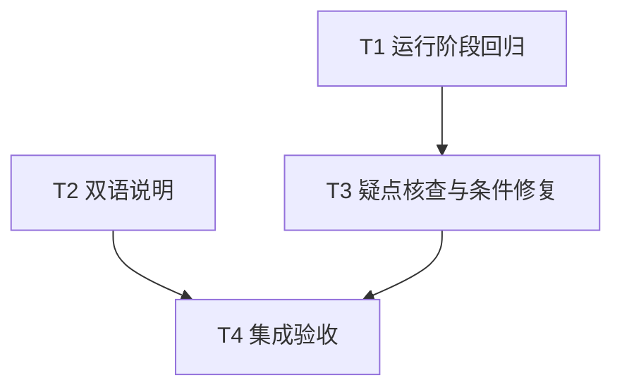

# rs-rayon-executor 异常隔离与文档边界改进实施计划

> **面向智能体执行者：** 使用 executing-plans 逐项实施本计划，各步骤通过复选框跟踪。本文件描述下一阶段工作，不表示方案生成阶段已经执行测试或获得提交、推送授权。

**目标：** 补齐运行异常回归、澄清 detached 错误边界，并以证据关闭最外层 panic 清理疑点。

**架构：** 保持有界接纳与 Rayon 调度架构。优先新增服务级测试及双语文案；只有 RE-003 核查支持时才局部修改运行保护。

**技术栈：** Rust 2024、Rust 1.94+、Rayon、qubit-executor、std channel/atomic、现有 Tokio 测试环境。

**工作目录：** `/data/working/qubit/rust-common/rs-rayon-executor`，留在当前 Paseo workspace；不使用临时目录替代指定设计与计划文件。

**设计依据：** [配套设计](design-20261106T145140356Z-6d134b05.md)。

## 范围与要求

- RE-001 纳入：运行阶段异常隔离服务级回归；原状态是测试缺口。
- RE-002 纳入：双语指南的 detached 结果与错误观察边界。
- RE-003 纳入核查：不是已确认故障，先验证再决定修复。
- 明确搁置/拒绝：无。
- 不创建或打开新的 Paseo workspace。保持现有 API，默认不改变依赖与下游源码。
- 允许为测试失败、ci-check.sh 错误、覆盖率不足新增或修改测试及必要源码，包括基线问题；不降低门槛。
- Git 提交、推送及发布按未来实施命令的明确授权处理，本计划不代替授权，也不添加未来默认禁令。

## 调度图

所有路径均相对工作目录。T1 与 T2 写入集合不相交，可属同一并行批次；当前不要求启动子智能体，单执行者可依次完成。共享 Cargo target 的重型命令归 T4 串行执行。

| 任务 | 前置任务 | 最小解锁产物 | 写入集合 | 本地验证 | 集成验证归属 | 审查时机 |
| --- | --- | --- | --- | --- | --- | --- |
| T1 运行阶段回归 | 无 | 可运行的公共 API 测试矩阵 | tests/running_resource_tests.rs | cargo test --test running_resource_tests | T4 | 立即审查 |
| T2 双语说明 | 无 | 对齐的错误观察说明 | doc/user_guide.md、doc/user_guide.zh_CN.md | 对照检查文案与链接 | T4 | 批量审查 |
| T3 疑点核查与条件修复 | T1 | 测试矩阵与实际依赖路径证据 | src/rayon_executor_service.rs（条件）、tests/running_resource_tests.rs（条件）、本计划的核查结果栏 | cargo test --test running_resource_tests | T4 | 立即审查 |
| T4 集成验收 | T2、T3 | 完整变更及核查结论 | 本计划的实施记录；必要的验证修复文件需显式记录 | 下述完整命令 | T4 | 立即审查 |

## 任务拓扑依赖图



## T1：新增运行阶段异常回归

**接口：** 输入为公开的 `RayonExecutorService`、`ExecutorService` 提交方法及 handle；输出是新增 integration test 目标，不新增生产 API。后续 T3 复用失败案例与测试 fixture。

- [x] 读取仓库规则、工作树状态、Cargo.toml 与现有 panic/cancellation tests。保留用户现有改动；记录起点与实际解析依赖，使用 `cargo metadata --format-version 1` 和 `cargo tree -i qubit-executor`，不把本地相邻 checkout 当作实际版本。
- [x] 新建 `tests/running_resource_tests.rs`，使用标准七行文件头。定义 `DEADLINE = Duration::from_secs(10)`、原子析构计数、抛出次级 payload 的 Drop fixture、运行/释放 channel，以及带截止时间的后继提交函数。
- [x] 依照设计矩阵写四个测试：`test_running_panic_payload_preserves_progress`、`test_detached_error_drop_preserves_progress`、`test_dropped_handle_success_drop_preserves_progress`、`test_dropped_handle_error_drop_preserves_progress`。
- [x] callable payload 测试复用现有 Payload/Secondary 模式；调用 `panic_any`，验证返回 Panicked 与次级 payload 未析构。detached 用返回自定义 Drop 错误的闭包。handle 丢弃案例通过 started/release channel 保证先 drop(handle)，再允许任务返回含 Drop 异常的 Ok 或 Err。
- [x] 每个案例验证后继普通任务执行一次；后继接纳可暂遇 Saturated，须在截止时间内重试新构造闭包；完成后 shutdown，限时等待终止并断言三项占用计数归零。失败时释放控制 channel，不能将阻塞任务永久留在后台。
- [x] 对可能 abort 的案例采用同一 integration test 二进制子进程运行：`current_exe()` 配合 `--exact <测试名> --nocapture` 和专用环境标识防递归；父进程用 `try_wait` 轮询截止时间，超时 kill 并 wait 回收，非零退出明确失败。子进程不得递归启动自身。
- [x] 运行 `cargo test --test running_resource_tests`。现有实现已隔离的场景可以直接通过，不制造失败；若出现真实失败，记录最短复现并交 T3，不能标记 T1 验收通过。

实现测试的核心顺序如下（fixture 与 timeout helper 按前述要求在同文件完整实现）：

```text
build(num_threads=1, task_capacity=1)
submit task -> wait started -> drop handle if required -> release task
observe expected terminal result if handle retained
retry ordinary submission until accepted or deadline
shutdown -> wait_termination_timeout(DEADLINE)
assert ordinary run count == 1
assert stats.queued == stats.running == stats.cancelling == 0
```

## T2：同步修订双语指南

**接口：** 无运行时接口；输出为等价的英文、中文错误观察说明。

- [x] 修改 `doc/user_guide.md` Errors and Diagnostics 的结果传播段落，采用设计文档中的英文文案；概念模型 detached 介绍处指向该边界。
- [x] 修改 `doc/user_guide.zh_CN.md` “错误与诊断”的对应段落，采用设计文档中的中文文案；概念模型同步提示。
- [x] 对照两种语言确认：submit 仅返回接纳状态、结果被丢弃、需要结果时改用 callable 或自行报告错误；不得声称 detached 自动提供日志或错误句柄。
- [x] 检查现有链接、示例及术语未失配。README 和 rustdoc 没有同类歧义时保持不动；若有同类歧义，将精确新增路径记入写入集合，只作相同语义补充。

## T3：核查 RE-003 并按证据决定源码修改

**接口：** 不更改 `run_one` 签名或公开 API；输入为 T1 的测试与实际依赖源码，输出为可复核的分支判断和条件修复。

- [x] 阅读实际依赖中的 TaskRunner::call/run/run_detached、TaskSlot、RunningTaskSlot、TaskState::publish_terminal_result 与 hook 通知路径，记录异常处理层次。检查 task 自身析构、无接收者结果析构与 waker/hook 异常是否已经被包含。
- [x] 复用 T1 测试确认当前路径；若要证明最外层可达，新增公共 API 复现。私有 helper 的人工注入只能证明防御逻辑，不得用来证明用户路径缺陷。
- [x] 若证实 payload 析构跳过 `finish_running`，先保留失败测试与超时/退出证据，再在 `src/rayon_executor_service.rs::run_one` 将 catch 结果处理改为：

```rust
if let Err(payload) = catch_unwind(AssertUnwindSafe(|| job.run())) {
    crate::internal::discard_panic_payload(payload);
}
```

- [x] 保持原有 finish_running 与后继派发逻辑，运行 `cargo test --test running_resource_tests`，确认失败案例转绿及普通工作继续。
- [x] 未复现分支不适用：公共 callable 路径已由失败回归证实可达，并按上方条件分支修复；没有采用无证据的防御性修改。
- [x] 在本计划末尾追加实际依赖版本、核查路径、命令/退出码、是否复现、是否修改及理由。源码变更必须有相应回归证据，不能以用户采纳代替验证。

## T4：集成与验收

**接口：** 输入为 T1—T3 产物；输出为可复核的最终 diff、RE-003 状态及验证记录。此任务负责全部重型验证，避免各任务重复运行。

- [x] 检查最终 diff，确认只有矩阵测试、双语说明、条件最小修复和必要验证修复；核对 RE-001—003 均有结果，不把未复现写成已修复。
- [x] 按项目规范运行 `./.infra/bin/align-ci.sh`，复核格式化结果，不覆盖用户无关变更。
- [x] 运行 `./.infra/bin/style-check.sh`。
- [x] 运行 `cargo test` 与 `cargo test --all-features`，默认包含 doctest；验证现有取消、并发接纳、容量重试和异步等待没有退化。
- [x] 运行 `RUSTDOCFLAGS="-D warnings" cargo doc --no-deps --all-features`，核对公开文档。
- [x] 运行 `./.infra/bin/ci-check.sh` 和 `./.infra/bin/coverage.sh`，使用项目现有阈值与 feature 配置。若 CI 已包含上述某检查，记录其实际覆盖范围，避免无理由重复执行。
- [x] 任何测试、CI 或 coverage 不满足时，定位原因并允许修改必要源码与测试，包括基线问题；逐项记录与本轮目标的关系。不得降低阈值、加忽略、删断言、使用生产 coverage cfg 或以“已有问题”为由宣布通过。修复后重跑受影响检查，最终门槛仍须满足。
- [x] 如需验证下游，先读 `../rs-execution-services` 中 CPU 等待和关闭测试的精确名称，在其仓库运行对应 `cargo test <实际过滤名>`。记录其依赖是否实际使用本次工作树；若仍使用 registry 版本，不能宣称验证了本次源码。没有下游配置修改授权时不永久改写其 Cargo 配置。
- [x] 核对用户实施命令对提交、推送的授权；仅在获得相应授权时执行。汇报变更、命令及退出码、覆盖率门槛、RE-003 分支结论和剩余限制。

## 交付核对表

| 设计要求 | 对应任务 | 完成证据 |
| --- | --- | --- |
| 四种运行异常、后继进展及零占用 | T1、T4 | 测试名与执行结果 |
| 双语 detached 错误观察边界 | T2、T4 | 两份指南 diff |
| 实际依赖及最外层可达性核查 | T3 | 源码路径、版本和核查结论 |
| 条件修复及不扩张 API | T3、T4 | 失败/通过证据或不修改理由 |
| 保持验证门槛并处理基线 | T4 | CI、coverage 及修复记录 |
| 当前 workspace 与范围控制 | T1—T4 | 最终路径、diff 和授权核对 |

## 实施记录约定

此处目前没有实施结果，方案阶段不虚填通过。未来执行者在本节追加每项任务结果、实际文件集合、验证输出摘要及 RE-003 判断；若实现事实改变设计假设，同步说明差异与原因。

### 本轮实施记录（2026-11-06）

- 工作仓库：`/data/working/qubit/rust-common/rs-rayon-executor`；实施 worktree：`/data/working/qubit/rust-common/.worktrees/rs-rayon-executor/codex/re-001-003-20261106`。原分支为 `dev-starfish`。本记录追加在用户提供的计划文件中，仅保存在工作区，不加入 Git 暂存区或提交。
- T1 完成：新增 `tests/running_resource_tests.rs`，覆盖 callable panic payload、detached 错误析构、无接收者成功结果析构、无接收者错误析构，以及额外的 detached panic payload 外层清理路径。五个测试均使用单 worker、容量 1、channel 顺序控制、10 秒期限、后继任务接纳与运行、终止等待和 queued/running/cancelling 清零检查；结果句柄通过限时 `try_get` 观察。初始 `cargo test --test running_resource_tests` 退出码 101，四例中的 callable panic 案例在隔离子进程中触发 `SIGABRT`（Rayon 检测到未处理的 panic），其余三例通过。修复后相同命令退出码 0，五例全部通过。
- T2 完成：更新 `doc/user_guide.md` 与 `doc/user_guide.zh_CN.md`，在概念模型加入 detached 边界提示，并将错误说明限定为返回结果句柄的提交通过 `get` 或 `.await` 观察失败；detached `submit` 仅返回接纳状态并丢弃最终结果。README 已清楚区分两类提交，无需修改。`git diff --check` 通过。
- T3 核查与修复：`cargo tree -i qubit-executor` 解析为 `qubit-executor v0.9.0`（registry 源码）。该版本源码 `/home/starfish/.cargo/registry/src/index.crates.io-1949cf8c6b5b557f/qubit-executor-0.9.0/src/task/task_runner.rs` 中，`TaskRunner::call` 捕获用户 panic 后，在 `Err(_)` 分支销毁原 panic payload；其析构再次 panic 时会越过任务句柄完成路径。`TaskState` 先发布终态，再发送 oneshot 结果并调用 hook；hook callback 有 `catch_unwind`，但捕获结果丢弃时其 payload 析构仍可能再次 unwind。`run_one` 现有外层保护可在此类逃逸时清理 payload 并继续回收计数。公开 callable 回归复现了该路径，并进一步证明外层捕获结果若直接析构也会触发 Rayon abort、跳过服务运行计数回收。`src/internal/callable_job.rs` 使用已有 `discard_panic_payload` 安全清理原 payload，再以安全 payload panic，使 `TaskRunner` 仍能发布 `TaskExecutionError::Panicked`；`src/rayon_executor_service.rs::run_one` 对任何逃逸 payload 使用同一 helper 清理后继续 `finish_running` 与后继派发。未改依赖、公共 API 或下游源码。
- T4 完成：最终变更文件为 `tests/running_resource_tests.rs`、`src/internal/callable_job.rs`、`src/rayon_executor_service.rs`、`doc/user_guide.md`、`doc/user_guide.zh_CN.md`。最终独立代码审查未发现 Critical 或 Important 问题。

验证记录（命令退出码）：

| 命令 | 结果 |
| --- | --- |
| `cargo metadata --format-version 1 --no-deps` | 0 |
| `cargo tree -i qubit-executor` | 0；`qubit-executor v0.9.0` |
| `cargo test --test running_resource_tests`（修复前） | 101；四例中的 callable panic 子进程复现 SIGABRT |
| `cargo test --test running_resource_tests`（修复后） | 0；5 passed |
| `./.infra/bin/align-ci.sh`（首次） | 1；新增测试头部许可证文本与仓库标准不一致，按现有集成测试格式修正后重跑通过 |
| `./.infra/bin/align-ci.sh`（修正后及最终） | 0；格式化与附带 clippy/check 通过 |
| `./.infra/bin/style-check.sh` | 0 |
| `cargo test` | 0；测试及 doctest 通过；最终版本也由 `ci-check.sh` 再次覆盖 |
| `cargo test --all-features` | 0；测试及 doctest 通过；最终版本重跑通过 |
| `RUSTDOCFLAGS="-D warnings" cargo doc --no-deps --all-features` | 0 |
| `./.infra/bin/ci-check.sh`（最终版本） | 0；构建、测试、文档、README、feature matrix、安全 advisory 与 coverage 门槛均通过 |
| `./.infra/bin/coverage.sh` | 0；函数 97.40%（75/77，门槛 ≥95%）、行 96.75%（417/431，门槛 >90%）、区域 96.55%（588/609，门槛 >85%） |
| `git diff --check` | 0 |

下游验证：真实 `rs-execution-services` 仓库起始及结束均保持 `dev-starfish` 干净状态。直接用其锁文件与本地 worktree patch 运行测试时，因锁定 Tokio 1.53.1 与本 crate 的 `^1.54` 依赖约束冲突而退出 101；随后从干净 HEAD 创建临时副本，仅在副本中更新 Tokio 至 1.54.1 并以 Cargo 配置 patch 指向本轮 worktree。编译输出确认使用本轮 `qubit-rayon-executor`，以下两项均退出码 0：`test_waits_for_cpu_tokio_blocking_and_io_capacity`、`test_cpu_full_capacity_wait_wakes_on_shutdown`。临时副本不属于下游仓库，也不提交。
