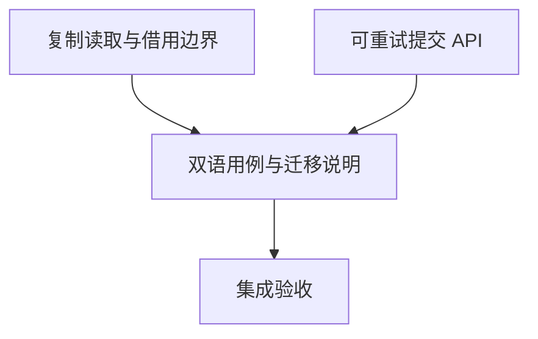

# rs-rayon-executor 容量通知与可重试提交实施计划

> 历史状态：本文所列实施任务已完成；结果见下方[实施结果记录（2026-11-07）](#实施结果记录2026-11-07)。前部计划说明保留该轮方案内容，任务勾选反映该轮实施状态；二者均按原样保留。

> 历史说明：本计划编写时描述的是当时尚未开始的下一阶段；该轮实施已完成，实际验证与 Git 记录见本文末尾的实施结果记录。

**目标：** 完成 RX-001 借用风险说明与复制读取，完成 RX-002 callable 拒绝归还接口。

**架构：** 保留有界队列与调度预约；以具体 job 类型完成原子接纳，在拒绝时恢复 callable。新增 API 为兼容性增量。

**技术栈：** Rust 2024、Rust 1.94+、Rayon、parking_lot、qubit-executor、可选 Tokio watch。

**工作目录：** `/data/working/qubit/rust-common/rs-rayon-executor`，留在当前 Paseo workspace，不创建或打开新 Paseo workspace。

**设计依据：** [配套设计](design-20261107T153934266Z-d8b4742e.md)。不使用临时目录替代指定文档。

## 范围与全局要求

- 纳入 RX-001、RX-002；明确搁置或拒绝：无；历史 RE 条目不自动重开。
- 保留旧公开 API 和消费语义；只新增 try_submit_callable、RejectedTask、generation、generation_and_update；不扩展 trait 或其他提交变体，不增加依赖。
- 新生产 rustdoc 用英文；README 和用户指南保持中英文语义一致。
- 本计划不授权修改下游；下游本树验证用临时 Cargo patch，记录实际依赖路径。
- 本计划编写时，所有步骤属于未来实施阶段。允许修复测试、CI、coverage 暴露的必要源码和测试问题，包括基线问题；禁止降低验证门槛。
- 提交、推送、发布依据未来实施命令的授权判断，不从本计划推断授权或永久禁令。

## 调度图

T1 与 T2 写入集合不相交，为同一并行批次；可由单执行者依次完成，不要求启动子智能体。共享 target 为资源组 R，重型验证仅 T4 串行执行。

| 任务 | 前置任务 | 最小解锁产物 | 写入集合（相对目标仓库） | 本地验证 | 集成验证归属 | 审查时机 |
| --- | --- | --- | --- | --- | --- | --- |
| T1 | 无 | 两个复制读取方法和借用边界证据 | src/capacity_changes.rs、tests/capacity_borrow_tests.rs | cargo test --all-features --test capacity_borrow_tests | T4/R | 立即审查 |
| T2 | 无 | 可恢复任务的原子接纳和提交 API | src/rejected_task.rs、src/lib.rs、src/rayon_executor_service.rs、src/rayon_executor_service_state.rs、src/internal/callable_job.rs、tests/retryable_submission_tests.rs | cargo test --test retryable_submission_tests | T4/R | 立即审查 |
| T3 | T1、T2 | 可运行双语用例与兼容说明 | README.md、README.zh_CN.md、doc/user_guide.md、doc/user_guide.zh_CN.md | 核对双语和示例类型，示例编译归 T4 | T4/R | 批量审查 |
| T4 | T3 | 最终验证、diff 与实施记录 | 本计划实施记录；必要验证修复的具体路径须登记 | 下述集成命令 | T4/R | 立即审查 |

## 任务拓扑依赖图



## T1：复制读取与借用边界

- [x] 读取当前规则、Git 状态和现有 watch 测试；保留所有已有未提交文件，不覆盖历史设计文档。记录实际 Tokio 版本。
- [x] 在 tests/capacity_borrow_tests.rs 添加 async-wait 门控测试。shutdown 产生通知；generation 不改变 has_changed，generation_and_update 后 has_changed 为 false，shutdown 重复通知不用于假定只增长一次。
- [x] 运行本任务命令，记录缺失方法导致的编译失败。
- [x] 在 CapacityChanges impl 增加以下实现及英文 rustdoc：

```rust
pub fn generation(&self) -> u64 { *self.receiver.borrow() }
pub fn generation_and_update(&mut self) -> u64 { *self.receiver.borrow_and_update() }
```

- [x] 为 borrow/borrow_and_update 增补 guard 持锁、短时复制、不得跨 await 或生命周期操作的警告，说明 generation 回绕且不等于可用容量。
- [x] 在同一测试文件增加子进程隔离试验：主线程持 borrow guard，另一线程通过 channel 宣告开始 shutdown；持锁期间完成 channel 不得到达；drop guard 后 recv_timeout(10s) 必须收到完成。父进程用 try_wait 和 10 秒截止时间回收超时子进程，避免主套件挂死。记录这是机制验证，不是现有下游事故。
- [x] 增加复制读取后 shutdown 正常返回的对照测试；重跑 focused tests 并审查新增接口。

## T2：拒绝归还任务

**接口契约：** RejectedTask<T> 的 reason(&self) -> &SubmissionError、into_parts(self) -> (SubmissionError,T)、crate 内 new；try_submit_callable 签名及 trait bounds 严格采用设计文档。state.admit 泛型返回原 Box<J>，成功前不擦除类型。

- [x] 读取现有 CallableJob、state.admit、所有调用点及本地实际 qubit-executor 解析来源；不要把相邻 checkout 默认当成实际构建依赖。
- [x] 新建 tests/retryable_submission_tests.rs。用单 worker、容量 1 和 started/release channel 稳定制造饱和；fixture 实现 Callable，持有唯一 Box、运行计数和 Drop 计数，不实现 Debug。
- [x] 添加 Saturated 归还测试：reason 正确、Box 指针不变、运行/析构数均为零；释放 blocker 并限时观察容量恢复，复用原 fixture 接纳；shutdown + wait_termination_timeout(10s) 后结果正确且执行/析构各一次。
- [x] 添加 Shutdown（包括既满又 shutdown）、丢弃拒绝值、成功结果/用户错误/panic、Debug 不含任务内容且无需 T: Debug 测试。添加旧 callable/tracked/runnable 拒绝消费测试，任务 Drop 重入 service.stats，通过隔离超时保证不锁死套件。
- [x] 运行 focused tests，记录新接口缺失的失败。
- [x] 新建 src/rejected_task.rs，按设计提供私有字段、访问器及 Debug/Display/Error；在 lib.rs 声明模块和根导出。不要依赖 qubit-tokio-executor。
- [x] 将 admit 改为设计中的泛型签名。错误分支返回 Err((reason, job))；成功时保留原检查顺序与 scheduled 计算，insert 时才转为 dyn。不能拆分为两次检查，不运行用户 callback。
- [x] 在 CallableJob 中增加回收方法，错误处理发生于 admit 返回、锁已释放之后：

```rust
pub(crate) fn into_task(self: Box<Self>) -> C {
    let Self { task, slot } = *self;
    drop(slot);
    task
}
```

- [x] try_submit_callable 创建 endpoint 和具体 Box<CallableJob>；admit 成功 dispatch 后返回 handle；失败从 box.into_task() 构造 RejectedTask。原 handle 和未接纳 slot 均在锁外销毁，不发布接纳。旧 submit_callable 映射拒绝原因并丢弃任务；tracked/runnable 错误也在锁外映射，所有调用点去掉过早 dyn 擦除。无调用的 submit_callable_with 可删除。
- [x] 重跑 focused tests；补查现有内部测试的 admit 调用并适配诊断，不引入为满足 unwrap 的生产 Debug 约束。运行本地相关取消、并发接纳测试，记录命令与结果。

## T3：双语说明与迁移示例

- [x] README 两种语言各新增一句“try_submit_callable 在拒绝时归还原 callable”，链接指南，不暗示旧提交也保留所有权。
- [x] 两种用户指南补齐借用警告、复制方法和回绕语义。
- [x] 新增完整重试示例：启用 async-wait，先订阅再提交；用具名函数返回 impl FnMut() -> Result<usize, io::Error>，内部捕获 Option<Box<[usize]>>，只在执行时 take；循环中将 task 移入 try_submit_callable，错误用 into_parts 取回，Saturated 等 changed，Shutdown 返回错误，其余原因传播。成功等待 handle，再 shutdown/await_termination。不得每次重新构造原始输入来掩盖所有权测试。
- [x] 说明 rs-execution-services 的 CPU 分支可将 OwnedWaitTask 替换为同类循环，blocking 分支继续保留；本轮无需下游源码迁移。
- [x] 对照双语逐段检查接口名、feature、错误处理、锁释放及旧接口语义，示例交 T4 编译。

## T4：集成验收与记录

- [x] 审查最终 diff 与设计，确认 T1—T3 全覆盖，登记额外验证修复的路径、原因，不覆盖用户已有改动。
- [x] 运行 ./.infra/bin/align-ci.sh，复核格式化变更；运行 ./.infra/bin/style-check.sh。
- [x] 串行运行 cargo test、cargo test --all-features、RUSTDOCFLAGS="-D warnings" cargo doc --no-deps --all-features。将指南中的完整 Rust 示例提取到仓库外验证 crate，配置本树 path 与指南所需 feature，cargo check --examples；这属于实施验证，不能只用 rustdoc 通过替代 Markdown 示例验证。
- [x] 运行 ./.infra/bin/ci-check.sh 和 ./.infra/bin/coverage.sh，记录退出码、现有 coverage 阈值与实际数值；若 CI 已包含等价检查则记录复用证据，避免无理由重复运行。
- [x] 使用 cargo tree 或 cargo metadata 记录 rs-executor adapter_contracts 及 rs-execution-services 的实际依赖路径。前者位于 ../rs-executor/tests/adapter_contracts，后者需要 Cargo --config patch.crates-io 临时指向本树；不得永久修改下游 Cargo 文件。检查各测试 manifest 和真实测试名后运行 Rayon 契约、CPU 等待/关闭相关测试，记录精确命令与解析来源。registry 版本的结果不能标为本树验证。
- [x] 测试、CI 或 coverage 失败时可新增/修改必要测试与源码，包括基线问题；先记录根因和与目标的关系，修复后重跑受影响门禁。不得降低阈值、忽略测试、删除断言或用生产 coverage cfg 绕过失败。
- [x] 按未来实施命令授权处理 Git 集成，不把方案阶段的限制延伸到实施。最终汇报代码变化、兼容性、下游验证边界和命令证据。

## 设计覆盖与自检

| 设计必须项 | 对应任务 |
| --- | --- |
| guard 警告、复制读取和已读语义、隔离验证 | T1、T3、T4 |
| 同一原任务返回、原子接纳、锁外清理 | T2、T4 |
| 旧接口兼容、不扩展 trait、不新增依赖 | T2、T3、T4 |
| 双语完整例子及下游迁移说明 | T3、T4 |
| 保持门槛、必要基线修复、实际依赖证据 | T4 |

以下结果记录为实施后追加；任务勾选反映该轮实施状态。

## 实施记录

该轮实际命令与结果见下节。


## 实施结果记录（2026-11-07）

- T1 RX-001 完成：新增 `generation`、`generation_and_update`；保留原借用 API 并说明 guard 持锁与生命周期风险；测试确认复制读取的已读语义，并在子进程中验证 shutdown 状态转换后通知受 guard 阻塞、释放后完成。
- T2 RX-002 完成：新增根导出的 `RejectedTask<T>` 与 `try_submit_callable`；接纳锁内保留具体 job，拒绝后锁外回收任务；旧 callable、tracked、runnable 的拒绝消费语义保持不变。
- T3 双语文档完成：README 增加能力说明；两本指南同步说明借用警告、旧接口消费行为、拒绝任务重试示例及下游 CPU 分支迁移边界；英文/中文示例均已独立编译。
- 变更范围为 13 个已提交文件，无破坏兼容性、无新增依赖、无下游源码修改。新增 crate 内部 `CallableJob::into_task(self: Box<Self>)` 对 `clippy::boxed_local` 使用单点 `#[expect]`，因为该具体 Box 是拒绝时归还的所有权载体；其余 Clippy 警告仍按 `-D warnings` 门禁执行。
- Tokio 实际解析版本为 1.54.1；目标 crate 的 `qubit-executor` 路径依赖解析到本工作区 `/data/working/qubit/rust-common/rs-executor`。

### 验证命令与结果

- `cargo test --all-features --test capacity_borrow_tests`：退出码 0，3/3；T1 初次编译曾受并行 T2 中间态影响退出 101，T2 调用点适配后通过。修正启动信号竞态后再次 3/3 通过。
- `cargo test --test retryable_submission_tests`：退出码 0，5/5；`cargo test --test cancellation_resource_tests`：6/6；`cargo test --test concurrent_admission_tests`：2/2；`cargo test --test callable_unwind_tests`：4/4。
- `cargo test`：最初因 T1 测试缺少 `async-wait` 门控退出 101；补门控后退出码 0。`cargo test --all-features`：退出码 0。
- `./.infra/bin/align-ci.sh`：格式/风格修正阶段曾因 Rustdoc、测试版权头/命名及 trait impl 文档缺项退出 1；按诊断补齐后退出码 0，内含全 target/all-features Clippy。
- `./.infra/bin/style-check.sh`：退出码 0；最终修改后 `align-ci.sh` 再次退出码 0。
- `RUSTDOCFLAGS="-D warnings" cargo doc --no-deps --all-features`：退出码 0；补充 guard 的终止等待措辞后再次退出码 0。
- 双语指南示例通过临时 crate 执行 `cargo check --examples`：退出码 0。英文示例首次因同一 `qubit-executor` 同时使用 canonical/symlink 路径造成 Cargo lockfile package collision 退出 101；统一路径后通过，随后中文示例亦通过。
- `./.infra/bin/ci-check.sh`：曾有一次在错误的 Display 断言上退出 1；改为核对 `SubmissionError` 的显示文本后通过。最终代码下退出码 0，覆盖率函数 98.33%（门槛 >=95%）、行 96.61%（门槛 >90%）、区域 97.06%（门槛 >85%）；该 CI 已包含 coverage collect，因此未重复运行独立 `coverage.sh`。
- 下游 `rs-executor/tests/adapter_contracts`：临时验证副本配合本树 path dependency，`cargo test --test contracts_tests` 退出码 0，10/10。首次临时副本混用 canonical/symlink executor 路径导致 package collision，统一路径后通过。
- 下游 `rs-execution-services` 的原清单/锁文件不一致：清单要求 `qubit-tokio-executor ^0.12`，原 lockfile 锁定 `0.11.0`；原仓库 `cargo tree` 与 `--locked` 均退出 101。未修改下游文件；在 `/tmp` 副本以 Cargo patch 指向本地相关 crate 后，`cargo tree -i qubit-rayon-executor` 明确解析到本轮 worktree，CPU 接纳/等待/关闭测试退出码 0，5/5。
- 最终 `git diff --check`：无输出，退出码 0。独立复查两轮后解决 Minor，最终复查 Critical/Important/Minor 均为无。

### Git 完成记录

- 起始分支 `dev-starfish`，起始提交 `3934c5e`。原工作区四份未跟踪设计/计划文档全程保留且未加入暂存区。
- 按用途提交：`51e355b feat: add copied capacity generation accessors`；`284a4b5 feat: return rejected Rayon callables`；`1509b82 docs: explain retryable Rayon submission`。
- 任务 worktree `codex/rx-capacity-retry` 已通过 `--ff-only` 整合到起始 `dev-starfish`，确认整合提交为 `1509b82` 且无未保存改动后删除 worktree。
- 整合提交依次以 `git merge --ff-only 1509b82` 同步并推送 `dev`、`main`、`dev-starfish`；三次 push 均成功。最终工作分支为 `dev-starfish`。
- `coverage.sh` 独立入口未重复执行，依据是 `ci-check.sh` 已运行等价 coverage 收集与既有阈值检查并报告实际覆盖率。
